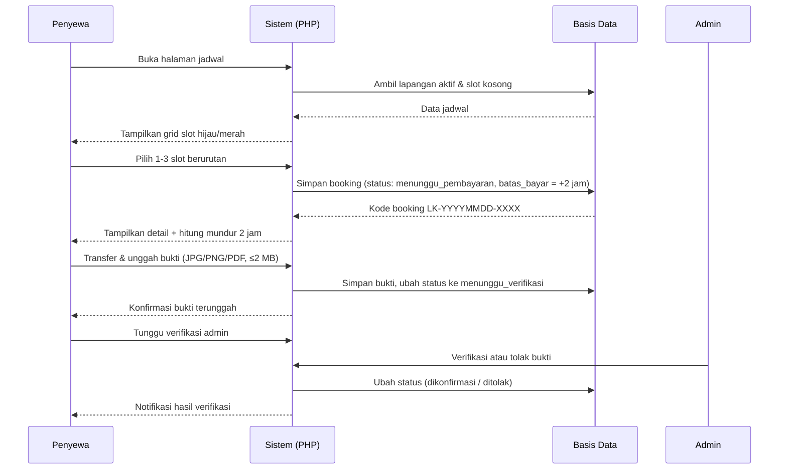
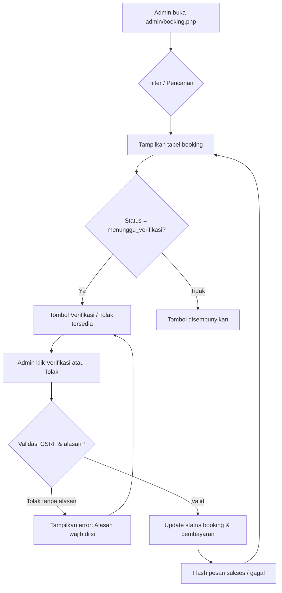
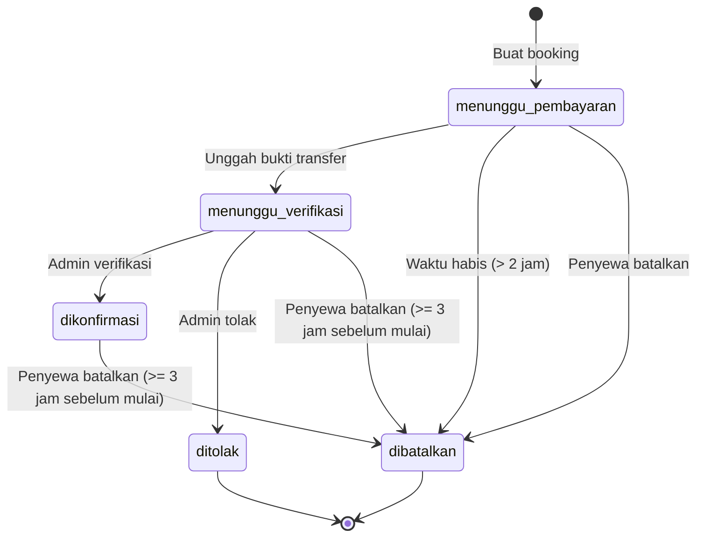

# JARINGAN SEMANATIK LAPANGANKU (Mermaid)

Diagram ini menggambarkan hubungan antar entitas utama dalam basis data dan alur sistem LapanganKu.

## 1. Diagram Relasi Basis Data (ERD Sederhana)

```mermaid
erDiagram
    users ||--o{ booking : membuat
    users ||--o{ pembayaran : verifikasi (verified_by)
    lapangan ||--o{ booking : dimiliki
    booking ||--o{ pembayaran : memiliki

    users {
        int id PK
        string nama
        string email UK
        string password
        enum role (penyewa, admin, pemilik)
        datetime created_at
    }

    lapangan {
        int id PK
        string nama
        enum jenis (futsal, badminton)
        string deskripsi
        int harga_per_jam
        time jam_buka
        time jam_tutup
        enum status (aktif, nonaktif)
    }

    booking {
        int id PK
        string kode UK
        int user_id FK
        int lapangan_id FK
        date tanggal
        time jam_mulai
        time jam_selesai
        int durasi
        int total_harga
        datetime batas_bayar
        enum status (menunggu_pembayaran, menunggu_verifikasi, dikonfirmasi, ditolak, dibatalkan)
        datetime created_at
    }

    pembayaran {
        int id PK
        int booking_id FK
        string bukti_file
        int verified_by FK
        datetime verified_at
        datetime uploaded_at
        text catatan_admin
    }
```

## 2. Alur Booking Penyewa



## 3. Alur Verifikasi Admin



## 4. Alur Pembatalan Otomatis



---

*Dokumentasi untuk Tugas Besar IMK — LapanganKu*
